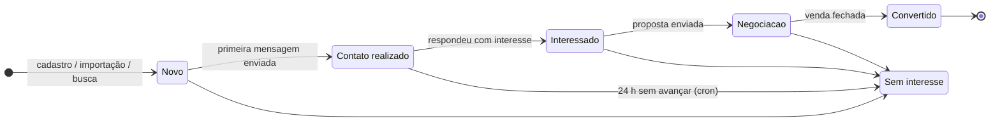
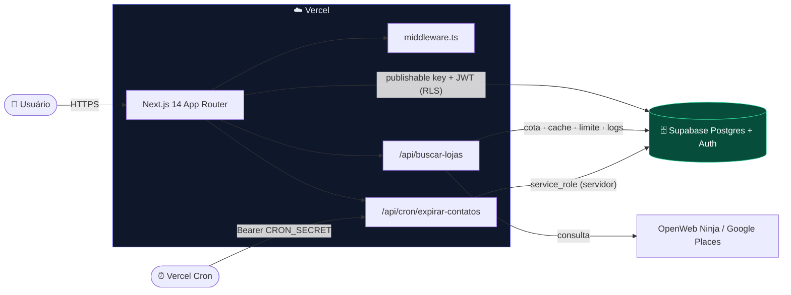
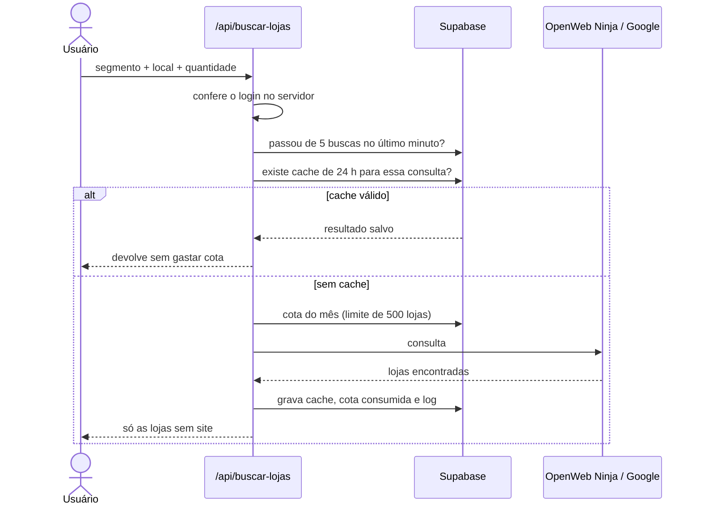
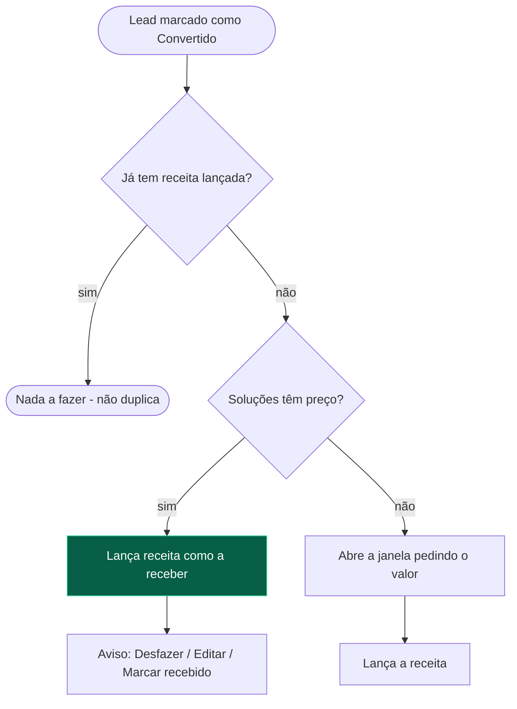

<div align="center">


<a href="https://github.com/henriquefbarrado/painel-lead">
  
</a>

<br />


**Prospecção ➜ Mensagem ➜ Follow-up ➜ Venda ➜ Financeiro**

[🌐 Demo (acesso por login)](https://painel-lead-mu.vercel.app) · [🧭 Telas](#-telas) · [🏗️ Arquitetura](#️-arquitetura) · [⚡ Começar](#-começar) · [🔐 Segurança](#-segurança) · [🧪 Testes](#-qualidade-e-testes)

</div>

---

<details>
<summary><b>📑 Sumário</b></summary>

1. [Visão geral](#-visão-geral)
2. [Destaques](#-destaques)
3. [Telas](#-telas)
4. [Ciclo de vida do lead](#-ciclo-de-vida-do-lead)
5. [Arquitetura](#️-arquitetura)
6. [Fluxos principais](#-fluxos-principais)
7. [Modelo de dados](#️-modelo-de-dados)
8. [Stack](#-stack)
9. [Começar](#-começar)
10. [Automação e CI/CD](#-automação-e-cicd)
11. [Segurança](#-segurança)
12. [Qualidade e testes](#-qualidade-e-testes)
13. [Estrutura do projeto](#-estrutura-do-projeto)
14. [Personalização](#️-personalização)
15. [Solução de problemas](#-solução-de-problemas)
16. [Roadmap](#-roadmap)

</details>

---

## ✨ Visão geral

Painel interno para quem vende **sites e páginas** para negócios locais. Ele cobre a rotina inteira de prospecção em um só lugar:


Pensado para **poucas pessoas**, cada uma com **login e leads próprios**. Nada é enviado sozinho: a mensagem abre pronta no WhatsApp e quem decide é você.

---

## 🌟 Destaques

| | Recurso | O que entrega |
|---|---|---|
| 🔎 | **Busca de lojas sem site** | Segmento + cidade/bairro → só negócios sem site próprio (Instagram, Facebook e link de WhatsApp contam como "sem site"). Cota mensal, cache de 24 h e limite por minuto |
| 💬 | **Mensagem pronta + Modo envio** | Primeiro contato com nome da loja e o seu nome. Uma loja por vez, "Enviei, próximo" e o status avança sozinho |
| ⏰ | **Follow-up que não deixa vazar** | Próximo contato e próxima ação por lead, aviso de atrasado e a tela **Hoje** com quem chamar agora |
| 🗂️ | **Pipeline Kanban** | Arrastar e soltar (no celular, "Mover para…") |
| 🤖 | **Venda automática** | Marcou **Convertido** → a receita entra no Financeiro, ligada ao lead, pelo preço das soluções |
| 🧹 | **Sem duplicados** | Compara telefone (com ou sem 55), nome + endereço e `place_id` |
| 🧭 | **Raio de distância** | De 1 a 50 km a partir de uma loja de referência (Haversine) |
| 🔐 | **Dados por usuário** | RLS no banco: cada pessoa só enxerga os próprios leads |
| ⏳ | **Expiração automática** | Quem fica em *Contato realizado* sem avançar por 24 h vira *Sem interesse* ("Não respondeu"), via cron |
| ⌨️ | **Paleta de comandos** | `Ctrl + K` para ir a qualquer tela ou lead |
| 🌗 | **Tema escuro e claro** | Escuro por padrão, responsivo, com barra inferior no celular |

---

## 🧭 Telas

| Rota | O que tem lá |
|---|---|
| 🏠 `/` | **Início**: funil, taxa de conversão, leads por segmento, contatos dos últimos 7 dias, motivos de perda, **meta mensal** e **backup em JSON** |
| 📆 `/hoje` | **Quem chamar agora**: retornos atrasados e de hoje, com WhatsApp e reagendamento em 1 clique |
| 👥 `/leads` | Lista com busca, filtros, ordenação, ações em massa, **Modo envio** e exportação CSV |
| 🪪 `/leads/[id]` | **Ficha do lead**: dados, status, follow-up, mensagem, histórico de contatos e receitas vinculadas |
| 🗂️ `/pipeline` | **Kanban** por etapa |
| 🔎 `/buscar` | **Buscar lojas sem site** por segmento e cidade/bairro |
| 📥 `/importar` | Importar de planilha (CSV ou Excel) com mapeamento de colunas |
| 💬 `/templates` | Modelos de mensagem e variáveis disponíveis |
| 💰 `/financeiro` | Receitas, despesas, lucro, a receber e **preços das soluções** |
| 📜 `/logs` | Histórico das buscas de lojas (**somente administrador**) |
| 🔑 `/login` | Entrada por e-mail e senha |

---

## 🎯 Ciclo de vida do lead



| Etapa | Significado | Mensagem pronta? |
|---|---|:---:|
| 🆕 **Novo** | Cadastrado, primeira mensagem ainda não enviada | ✅ primeiro contato |
| 💬 **Contato realizado** | Primeira mensagem enviada | ➖ etiqueta |
| 🔥 **Interessado** | Respondeu e demonstrou interesse | ➖ etiqueta |
| 🤝 **Negociação** | Proposta enviada, em decisão | ➖ etiqueta |
| 🎉 **Convertido** | Fechou negócio (gera a receita) | ➖ etiqueta |
| 🚫 **Sem interesse** | Recusou, não respondeu ou não é o perfil (guarda o **motivo da perda**) | ➖ etiqueta |

> Só o primeiro contato tem texto pronto. Depois disso a conversa acontece direto no WhatsApp e o painel serve para organizar o andamento. Detalhes e rotina sugerida em [STATUS-DOS-LEADS.md](STATUS-DOS-LEADS.md).

---

## 🏗️ Arquitetura



**Decisões de projeto**

| Decisão | Motivo |
|---|---|
| **Regras de acesso no banco (RLS), não só na tela** | Esconder um botão não protege dado. Mesmo chamando a API por fora, cada usuário só lê os próprios leads |
| **Cliente do navegador usa só a chave publishable** | Ela é pública por definição. A `service_role` existe apenas no servidor, para o cron |
| **Busca de lojas passa por rota de servidor** | A chave do provedor nunca chega ao navegador, e cota, cache e limite de frequência ficam num ponto único |
| **Regras de negócio em `lib/` como funções puras** | Conversão, follow-up, financeiro e duplicados são testáveis sem banco nem interface |
| **Migrações SQL idempotentes** | `if not exists` e `drop ... if exists`: dá para rodar de novo sem quebrar |
| **Compatibilidade com dados antigos** | A etapa removida *Entrar em contato* é tratada como *Novo* ao carregar (`normalizarStatus`) |
| **Mensagem padrão em código, não em tabela** | Um texto único e versionado no Git, sem divergência entre usuários |

---

## 🔄 Fluxos principais

<details>
<summary><b>🔎 Buscar lojas sem site</b> (cota, cache e limites)</summary>



A chave do cache ignora acento, caixa e espaços repetidos, então `Barbearia` e `  barbearía ` caem na mesma consulta. Cada busca fica registrada em `logs_busca`, e só o administrador consegue ler.

</details>

<details>
<summary><b>🤖 Venda automática</b> (Convertido → Financeiro)</summary>



O valor é a soma dos preços cadastrados em **Financeiro → Preços das soluções** para as soluções marcadas no lead. A receita fica ligada ao lead e alimenta ticket médio, receita por segmento e custo por lead.

</details>

---

## 🗄️ Modelo de dados

```mermaid
erDiagram
  AUTH_USERS ||--o{ LEADS : "é dono de"
  LEADS ||--o{ CONTATOS : "histórico"
  LEADS ||--o{ FINANCEIRO : "receitas vinculadas"
  AUTH_USERS ||--o{ BUSCAS : "consome cota"
  AUTH_USERS ||--o{ LOGS_BUSCA : "gera"

  LEADS {
    uuid id PK
    uuid user_id FK
    text nome_loja
    text whatsapp
    text segmento
    text_array solucoes
    text status
    timestamptz proximo_contato
    timestamptz ultimo_contato
    text motivo_perda
    text place_id
  }
  CONTATOS {
    uuid id PK
    uuid lead_id FK
    text tipo
    text nota
    timestamptz contatado_em
  }
  FINANCEIRO {
    uuid id PK
    uuid lead_id FK
    text tipo
    numeric valor
    text categoria
    text situacao
    boolean recorrente
  }
  TEMPLATES { uuid id PK text nome text status text segmento }
  CONFIG { text chave PK jsonb valor }
  BUSCAS { uuid id PK text consulta int qtd boolean do_cache }
  BUSCA_CACHE { text chave PK jsonb resultado }
  LOGS_BUSCA { uuid id PK text usuario text segmento text local int cota_gasta }
```



**Quem vê o quê**

| Tabela | Visibilidade |
|---|---|
| `leads` e `contatos` | **Por usuário**: só os próprios leads e o histórico deles |
| `financeiro`, `templates`, `config`, `busca_cache` | Compartilhadas entre os usuários logados |
| `buscas` | Compartilhada (a cota mensal é uma só) |
| `logs_busca` | Todos gravam, **só o administrador lê** |

**Migrações** (SQL Editor do Supabase, **nesta ordem**):

| # | Arquivo | Para quê |
|:-:|---|---|
| 1 | `schema.sql` | Tabela de leads |
| 2 | `financeiro.sql` | Receitas e despesas |
| 3 | `segmentos.sql` | Segmento e soluções do lead |
| 4 | `contatos.sql` | Histórico de contatos |
| 5 | `melhorias.sql` | Follow-up, templates, meta, cota e cache da busca, vínculo financeiro ↔ lead |
| 6 | `por-usuario.sql` | Leads por usuário (RLS) |
| 7 | `logs-busca.sql` | Logs de busca (somente administrador) |

> `remover-etapa-entrar-em-contato.sql` só é necessário se você tem registros na etapa antiga *Entrar em contato*: ele os move para **Novo**. O `etapa-entrar-em-contato.sql` é histórico.

---

## 🧱 Stack

| Camada | Tecnologia |
|---|---|
| ⚛️ **Front** | [Next.js 14](https://nextjs.org) (App Router), React 18, TypeScript estrito |
| 🎨 **UI** | [Tailwind CSS](https://tailwindcss.com), [lucide-react](https://lucide.dev), tema por variáveis CSS |
| 🗄️ **Dados e auth** | [Supabase](https://supabase.com): Postgres, Auth e RLS (`@supabase/ssr`) |
| 📥 **Importação** | `papaparse` (CSV) e `xlsx` (Excel) |
| 🔎 **Busca de lojas** | OpenWeb Ninja (plano grátis) ou Google Places API (New) |
| ☁️ **Hospedagem** | [Vercel](https://vercel.com), com Cron |
| 🤖 **CI** | GitHub Actions |

---

## ⚡ Começar

> Pré-requisito: **Node.js 18+**

**1️⃣ Banco.** Crie um projeto no [Supabase](https://supabase.com) e rode os SQLs da [tabela de migrações](#️-modelo-de-dados), na ordem.

**2️⃣ Usuários.** Em **Authentication → Users**, crie cada pessoa (marque *Auto Confirm User*). Depois desative o cadastro público em **Authentication → Providers → Email** (*Allow new users to sign up*).

**3️⃣ Variáveis de ambiente.**

```bash
cp .env.example .env.local        # PowerShell: Copy-Item .env.example .env.local
```

| Variável | Onde roda | Obrigatória | De onde vem |
|---|:-:|:-:|---|
| `NEXT_PUBLIC_SUPABASE_URL` | navegador + servidor | ✅ | Supabase → *Project Settings → Data API* (só a base, `https://xxxx.supabase.co`) |
| `NEXT_PUBLIC_SUPABASE_PUBLISHABLE_KEY` | navegador + servidor | ✅ | Supabase → *API Keys* (chave **publishable**; `NEXT_PUBLIC_SUPABASE_ANON_KEY` também é aceita) |
| `SUPABASE_SERVICE_ROLE_KEY` | 🔒 **só servidor** | cron | Supabase → *API Keys* (chave **secret**). Nunca com prefixo `NEXT_PUBLIC_` |
| `CRON_SECRET` | 🔒 **só servidor** | cron | Gere com `openssl rand -hex 32` |
| `OPENWEBNINJA_API_KEY` | 🔒 só servidor | busca | [Cadastro grátis](https://app.openwebninja.com/signup): 500 lojas/mês, sem cartão. Tem prioridade sobre o Google |
| `GOOGLE_MAPS_API_KEY` | 🔒 só servidor | alternativa | Google Cloud → *Places API (New)*, com faturamento |

**4️⃣ Rodar.**

```bash
npm install
npm run dev
```

Abra **http://localhost:3000** e entre com um dos usuários. 🎉

**Scripts**

| Comando | O que faz |
|---|---|
| `npm run dev` | Desenvolvimento com recarga ao salvar |
| `npm run build` | Build de produção |
| `npm start` | Serve o build (rode o `build` antes) |
| `npm run prod` | `build` + `start` em sequência |
| `npm test` | Compila e roda os testes das regras de negócio |
| `npm run typecheck` | Confere os tipos do TypeScript |

---

## 🤖 Automação e CI/CD

### Expiração automática (Cron)

Um job da Vercel chama `GET /api/cron/expirar-contatos`. A rota confere o `Authorization: Bearer <CRON_SECRET>` e move para **Sem interesse** (motivo "Não respondeu") os leads que estão em **Contato realizado** há mais de **24 horas** sem avançar (constante `HORAS_SEM_RESPOSTA` em `lib/expirar-contatos.ts`). Como o cron enxerga os leads de todos os usuários, ele usa a `service_role`, só no servidor.

> ⚠️ **Plano Hobby da Vercel:** o cron só pode rodar **uma vez por dia**, e a Vercel pode disparar em qualquer minuto da hora agendada. O `vercel.json` atual usa `0 * * * *` (a cada hora), e uma expressão mais frequente que diária **faz o deploy falhar** no Hobby. Em Hobby, use algo como `0 9 * * *`. Cron só roda em produção, não em previews.

### Fluxo de entrega


O workflow `.github/workflows/auto-pr-merge.yml` roda a cada push na branch `testes`: instala com `npm ci`, executa `npm test`, `npm run typecheck` e `npm run build` e, se tudo passar, abre (ou reaproveita) o PR para a `main` e faz o merge. As variáveis do build vêm dos **Secrets** do repositório (`NEXT_PUBLIC_SUPABASE_URL`, `NEXT_PUBLIC_SUPABASE_PUBLISHABLE_KEY`, `OPENWEBNINJA_API_KEY`, `GOOGLE_MAPS_API_KEY`).

```bash
git checkout testes                 # ou: git checkout -b testes
git add . && git commit -m "o que mudou"
git push origin testes              # o resto é automático
```

### Publicar na Vercel

1. Importe o repositório e cadastre as variáveis acima em **Settings → Environment Variables** (**Production**).
2. A cada merge na `main`, o deploy acontece sozinho. Pelo terminal: `npm i -g vercel`, `vercel link` (uma vez) e `vercel --prod`.

> Mudar algo no **Supabase** (tabelas, usuários, dados) **não** exige novo deploy. Mudar **código** ou **variáveis de ambiente**, sim.

---

## 🔐 Segurança

- 🙈 **Nenhum segredo no código.** `.env.local` fica fora do Git e o `.env.example` traz só os nomes.
- 🛡️ **RLS em todas as tabelas.** Leads e histórico são por usuário, aplicados no banco.
- 🔑 **Duas chaves, dois papéis.** O navegador usa só a **publishable**. A **`service_role`** vive em `lib/supabase/admin.ts`, só no servidor (cron), e nunca deve ser importada em componente `'use client'` nem receber prefixo `NEXT_PUBLIC_`.
- ⏰ **Cron protegido** por `CRON_SECRET`. Sem o segredo configurado, a rota responde 401.
- 🚦 **`/api/buscar-lojas` valida o login no servidor**, aplica cota mensal, cache de 24 h e limite de 5 buscas por minuto. A chave do provedor nunca vai ao navegador.
- 👮 **Logs de busca restritos** ao administrador, tanto na interface (`lib/usuarios.ts`) quanto no banco (`logs-busca.sql`).
- 📤 **CSV seguro:** a exportação escapa aspas e ponto e vírgula e bloqueia fórmulas (`=`, `+`, `-`, `@`), evitando injeção de fórmula no Excel.
- 🚫 **Cadastro público desativado** no Supabase: só entra quem você criou.
- 💸 Restrinja a chave do Google à *Places API (New)* e configure alerta de orçamento e limite diário no Google Cloud.

---

## 🧪 Qualidade e testes

`npm test` compila os testes com `tsc` e roda com o `node --test` nativo, sem framework extra. São **14 testes** das regras de negócio, escritos como funções puras:

| Área | O que garante |
|---|---|
| 🎯 Conversão | Fechados ÷ abordados; leads novos não contam |
| 🔁 Compatibilidade | A etapa antiga *Entrar em contato* vira *Novo* |
| 💰 Financeiro | Pendente não entra no lucro, só em "a receber"; receita por segmento; despesas recorrentes copiadas uma única vez |
| ⏰ Follow-up | Atrasado, hoje, futuro e sem data |
| 💬 Mensagens | Variáveis novas e antigas; primeiro contato fixo; demais etapas sem texto automático |
| 🧹 Duplicados | Telefone com ou sem 55 e nome + endereço |
| 📤 CSV | Escape de aspas e bloqueio de fórmulas |
| 🔎 Busca | Chave de cache estável (acento, caixa e espaços) |
| 📍 Utilidades | Número de WhatsApp e distância |
| 🤖 Venda automática | Soma de preços das soluções e fallback quando não há preço |

Além dos testes, o CI roda **typecheck** (`tsc --noEmit`) e o **build** de produção.

---

## 🗺️ Estrutura do projeto

<details>
<summary><b>📂 Ver as pastas</b></summary>

```
app/
  page.tsx                       Início (dashboard)
  hoje/  leads/  leads/[id]/     Retornos, lista e ficha do lead
  pipeline/                      Kanban
  buscar/  importar/             Captação de leads
  templates/  financeiro/        Mensagens e finanças
  logs/  login/                  Logs (admin) e entrada
  error.tsx                      Tela de erro global
  api/
    buscar-lojas/route.ts        Busca de lojas (cota, cache, limite, logs)
    cron/expirar-contatos/       Cron de expiração (service_role)
components/                      Shell (menu), Painel, Pipeline, LeadCard, LeadForm,
                                 FilaEnvio, VendaDialog, PrecosSolucoes, CommandPalette…
lib/
  types.ts                       Etapas, cores e ordem do funil
  message-template.ts            Mensagem padrão e número do WhatsApp
  templates.ts                   Variáveis e montagem da mensagem
  metricas.ts                    Conversão, follow-up e cálculos financeiros
  vendas.ts · precos.ts          Venda automática e preços das soluções
  cota.ts                        Cota mensal, limite por minuto e chave do cache
  expirar-contatos.ts            Regra do cron das 24 h
  importar.ts · leads-csv.ts     Importação (CSV/Excel) e exportação
  segmentos.ts · geo.ts          Catálogo de segmentos e distância
  usuarios.ts                    Nome por e-mail e administrador
  supabase/                      Clientes: client.ts · server.ts · admin.ts
supabase/                        Migrações SQL (ordem na seção Modelo de dados)
tests/                           Testes das regras de negócio
.github/workflows/               CI e merge automático
middleware.ts                    Sessão e proteção das rotas
vercel.json                      Agendamento do cron
```

</details>

---

## 🛠️ Personalização

| Quero mudar… | Onde |
|---|---|
| ✍️ O texto do primeiro contato | `lib/message-template.ts` (constante `PRIMEIRO_CONTATO`) |
| 🏷️ Nome, cor e ordem das etapas | `lib/types.ts` |
| 👤 Nome de cada usuário e o administrador | `lib/usuarios.ts` |
| 🏭 Segmentos e soluções | `lib/segmentos.ts` |
| 💵 Preço de cada solução | Tela **Financeiro → Preços das soluções** (sem código) |
| ⏳ Prazo de expiração do contato | `HORAS_SEM_RESPOSTA` em `lib/expirar-contatos.ts` |
| 🔎 Limites da busca | `lib/cota.ts` (`LIMITE_MES`, `BUSCAS_POR_MINUTO`, `CACHE_HORAS`) |
| 🎨 Cores do tema | `app/globals.css` |

Marcadores aceitos na mensagem: `{SEU_NOME}` e `{NOME_DA_LOJA}`.

---

## 🩺 Solução de problemas

| Sintoma | Causa provável | Solução |
|---|---|---|
| `Invalid API key` no login | Variável com nome errado ou servidor não reiniciado | Confira `NEXT_PUBLIC_SUPABASE_URL` e a chave **publishable**, e reinicie o `npm run dev` |
| `relation "..." does not exist` | Migração não rodou | Rode os SQLs **na ordem** da seção [Modelo de dados](#️-modelo-de-dados) |
| `Could not find the table ... in the schema cache` | Cache do Supabase desatualizado | Rode `notify pgrst, 'reload schema';` no SQL Editor |
| Lista de leads vazia após o `por-usuario.sql` | Leads sem dono ficam invisíveis | Rode `select count(*) from leads where user_id is null;`. O resultado deve ser **0** |
| Busca de lojas retorna erro | Falta a chave do provedor ou a cota acabou | Defina `OPENWEBNINJA_API_KEY` e confira a cota do mês na própria tela |
| Deploy falha citando *cron* | Plano Hobby só aceita cron 1×/dia | Troque o schedule do `vercel.json` para algo diário, como `0 9 * * *` |
| Cron responde `401` | `CRON_SECRET` ausente ou diferente | Cadastre o mesmo valor na Vercel (**Production**) e faça um novo deploy |
| `rejected (non-fast-forward)` no push | O GitHub tem commits que a sua pasta não tem | `git pull --rebase origin main` e depois `git push`. Não use `--force` |
| Build quebra com `Module not found` | Dependência instalada só na sua máquina | `npm install nome-do-pacote` e faça commit do `package.json` e do `package-lock.json` |

---

## 🔮 Roadmap

- [ ] 📍 Geocodificação automática pelo endereço
- [ ] 🔔 Lembretes por e-mail ou push dos retornos do dia
- [ ] 👥 Permissões por perfil (administrador × vendedor)
- [ ] 📊 Relatório mensal em PDF
- [ ] 🧾 Cobrança com lembrete de receitas "a receber" vencidas

---

<div align="center">

Feito com ☕ e muita prospecção por **Henrique** · [BYS, Build Your Site](https://github.com/henriquefbarrado)

⭐ Se o projeto te ajudou, deixe uma estrela no repositório.


</div>
